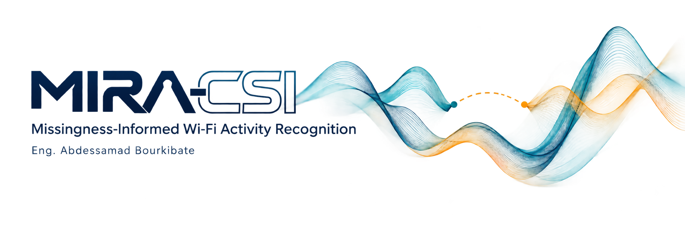
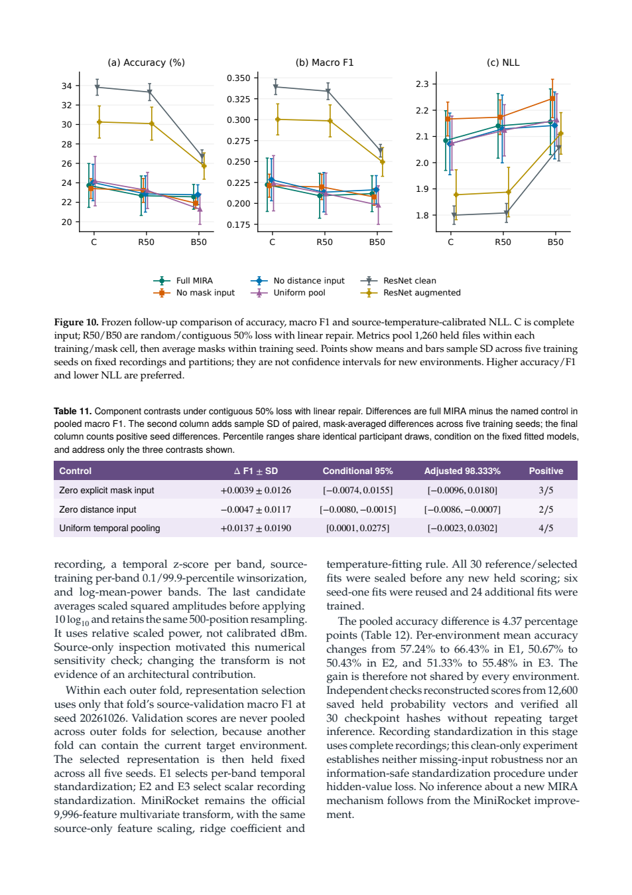
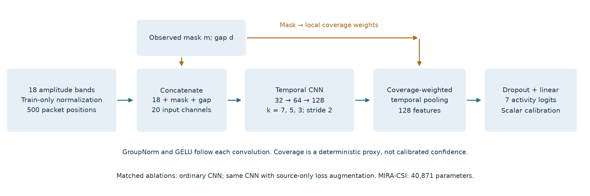
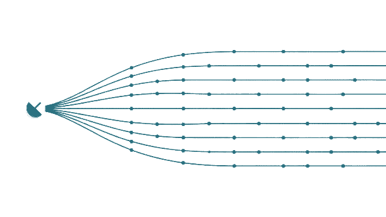
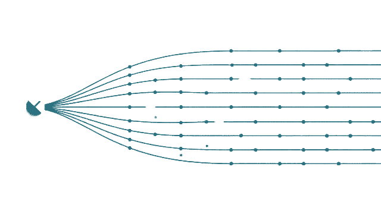
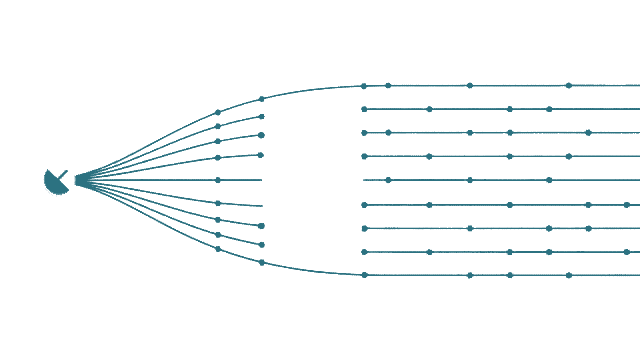
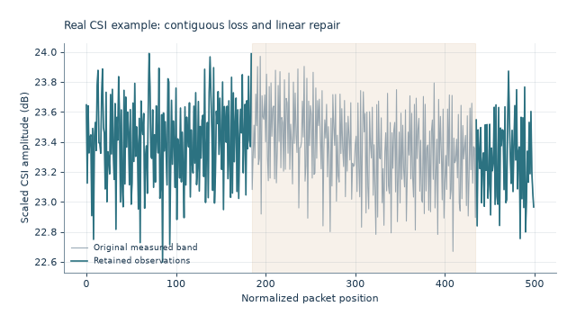
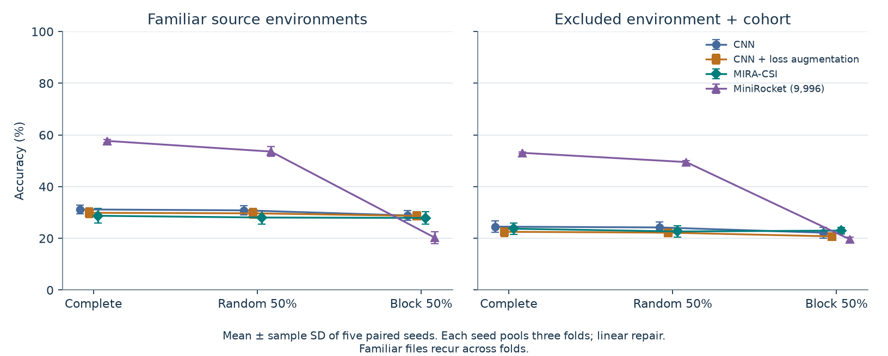

<p align="center">
  <picture>
    <source media="(prefers-color-scheme: dark)" srcset="docs/assets/cover-dark-transparent.png">
    <source media="(prefers-color-scheme: light)" srcset="docs/assets/cover-light-transparent.png">
    
  </picture>
</p>

<p align="center">
  
  
  
  
  
</p>

<p align="center">
  <a href="https://colab.research.google.com/github/ABDESSAMAD-BOURKIBATE/mira-csi/blob/main/notebooks/quickstart.ipynb"></a>
  <a href="https://github.com/ABDESSAMAD-BOURKIBATE/mira-csi/releases/tag/v0.2.0"></a>
  
  <a href="LICENSE"></a>
  <a href="https://orcid.org/0009-0000-6186-8071"></a>
</p>

<p align="center"><a href="paper/README.md">Research paper</a> · <a href="#quick-start">Quick start</a> · <a href="#architecture">Architecture</a> · <a href="#evaluation">Verified results</a> · <a href="#repository-map">Repository map</a> · <a href="MODEL_CARD.md">Model card</a> · <a href="#citation">Citation</a></p>

<a id="overview"></a>
<h3><picture>
  <source media="(prefers-color-scheme: dark)" srcset="docs/assets/headings/overview-dark-v2.svg">
  <source media="(prefers-color-scheme: light)" srcset="docs/assets/headings/overview-light-v2.svg">
  
</picture></h3>

**MIRA-CSI** — Missingness-Informed Recognition of Activities from Wi-Fi CSI — is a compact PyTorch research model that makes observation availability explicit when classifying incomplete CSI recordings. This repository provides a runnable saved-model predictor, the original evaluated release, and a documented follow-up that tests the individual components against conventional residual CNN controls.

**Developer and research lead:** Eng. **Abdessamad Bourkibate**  
Software & Cybersecurity Engineer | AI & EdTech — **Share'In Holding**

**Status:** experimental offline classifier, evaluated on seven activity labels. The original release contains 60 fits; a separate frozen follow-up contains 90 fits across six configurations. The component results are mixed and recognition accuracy remains limited. A clean-only representation study improves the **MiniRocket comparator** to 57.44%; that is a separate result, not MIRA's accuracy. [Evidence and scope](evaluation/component-controls/README.md).

**Read the study:** [complete research manuscript — PDF](paper/manuscript.pdf) · [source and page previews](paper/README.md) · [recalculate the frozen analysis](studies/component_removal/README.md). The 21-page author version includes all reported controls and limitations; it is not journal peer reviewed and has no assigned DOI.

**Download the evidence:** [v0.2.0 research release](https://github.com/ABDESSAMAD-BOURKIBATE/mira-csi/releases/tag/v0.2.0) · [validated reproducibility supplement](https://github.com/ABDESSAMAD-BOURKIBATE/mira-csi/releases/download/v0.2.0/MIRA-CSI-reproducibility-supplement-20261028-validated.zip) · [SHA256 checksums](https://github.com/ABDESSAMAD-BOURKIBATE/mira-csi/releases/download/v0.2.0/SHA256SUMS.txt). The original v0.1.0 predictor package remains linked in Quick start.

<details>
<summary><strong>Preview actual manuscript pages</strong></summary>

<p align="center">
  <a href="paper/manuscript.pdf"></a>
  <a href="paper/manuscript.pdf"></a>
</p>

These are rendered pages of the linked PDF. See [paper/MANIFEST.json](paper/MANIFEST.json) for the matching PDF and source hashes.

</details>

<a id="quick-start"></a>
<h3><picture>
  <source media="(prefers-color-scheme: dark)" srcset="docs/assets/headings/quick-start-dark-v2.svg">
  <source media="(prefers-color-scheme: light)" srcset="docs/assets/headings/quick-start-light-v2.svg">
  
</picture></h3>

Open the [executed saved-model notebook](notebooks/quickstart.ipynb) in Colab, or use the commands below. The notebook has been run top-to-bottom on a Windows CPU and retains its actual outputs.

```sh
git clone https://github.com/ABDESSAMAD-BOURKIBATE/mira-csi.git
cd mira-csi
python -m pip install numpy
python -m pip install torch==2.11.0 --index-url https://download.pytorch.org/whl/cpu
```

Download [the verified model/results package](https://github.com/ABDESSAMAD-BOURKIBATE/mira-csi/releases/download/v0.1.0/mira-csi-verified-results.zip) and extract it into the project directory, producing `results/`. Then run:

```sh
python predict.py --checkpoint results/checkpoints/mira_csi_E3_s20261026.pt --input results/demo_input.npy --calibration results/runs/mira_csi_E3_s20261026.json
```

Add `--observed results/demo_observed.npy` for the matched block-loss example. A CPU is sufficient for saved-model inference. The predictor returns an activity label and seven model probabilities. The included example is a public recorded CSI segment.

Exact evaluated package versions are in [`evaluation/package_versions.json`](evaluation/package_versions.json).

<a id="architecture"></a>
<h3><picture>
  <source media="(prefers-color-scheme: dark)" srcset="docs/assets/headings/architecture-dark-v2.svg">
  <source media="(prefers-color-scheme: light)" srcset="docs/assets/headings/architecture-light-v2.svg">
  
</picture></h3>

<p align="center"><picture>
  <source media="(prefers-color-scheme: dark)" srcset="docs/assets/architecture-dark.png">
  <source media="(prefers-color-scheme: light)" srcset="docs/assets/architecture-light.png">
  
</picture></p>

| Component | Implementation |
|---|---|
| Signal input | 18 amplitude bands × 500 normalized packet positions |
| Missingness input | Observation mask and distance to nearest observation |
| Encoder | 1D convolutions: 32 → 64 → 128 channels, GroupNorm, GELU |
| Pooling | Temporal features weighted by local observation coverage |
| Output | Seven logits, with source-validation temperature scaling |
| Model size | 40,871 trainable parameters |

The initial comparison includes an ordinary amplitude CNN (40,423 parameters), the same CNN with source-only loss augmentation, and the official MiniRocket transform with **9,996 features**. The follow-up tests zero explicit-mask input, zero distance input and uniform pooling in otherwise matched compact networks, plus two conventional residual CNN controls. Under the defined nearest-support distance, **`m_t = I[d_t = 0]`**: the mask is fully recoverable from the distance channel. Zero mask input therefore tests an explicit encoding, rather than removal of missingness information; mask-dependent coverage pooling also remains available. Mask, gap and learned missing-CSI recovery methods have prior art; [`PRIOR-ART.md`](PRIOR-ART.md) documents attribution and the limits of the novelty claim.

<a id="measurement-availability-case-by-case"></a>
<h4><picture>
  <source media="(prefers-color-scheme: dark)" srcset="docs/assets/headings/measurement-availability-case-by-case-dark-v2.svg">
  <source media="(prefers-color-scheme: light)" srcset="docs/assets/headings/measurement-availability-case-by-case-light-v2.svg">
  
</picture></h4>

The first three clips are abstract data-flow illustrations. Teal paths represent parallel streams and dots represent observations; spacing and motion do not encode measured amplitudes, time, radio propagation or a numerical loss rate. The final plot uses the released real CSI example.

<a id="complete-observations"></a>
<h4><picture>
  <source media="(prefers-color-scheme: dark)" srcset="docs/assets/headings/complete-observations-dark-v2.svg">
  <source media="(prefers-color-scheme: light)" srcset="docs/assets/headings/complete-observations-light-v2.svg">
  
</picture></h4>

<p align="center"><picture>
  <source media="(prefers-color-scheme: dark)" srcset="docs/assets/case-complete-dark.webp">
  <source media="(prefers-color-scheme: light)" srcset="docs/assets/case-complete-light.webp">
  
</picture></p>

Available samples enter preprocessing together. Complete input means no additional mask was imposed; it does not establish that acquisition was free from noise or packet loss.

<a id="random-missing-positions"></a>
<h4><picture>
  <source media="(prefers-color-scheme: dark)" srcset="docs/assets/headings/random-missing-positions-dark-v2.svg">
  <source media="(prefers-color-scheme: light)" srcset="docs/assets/headings/random-missing-positions-light-v2.svg">
  
</picture></h4>

<p align="center"><picture>
  <source media="(prefers-color-scheme: dark)" srcset="docs/assets/case-random-loss-dark.webp">
  <source media="(prefers-color-scheme: light)" srcset="docs/assets/case-random-loss-light.webp">
  
</picture></p>

Scattered gaps illustrate non-contiguous unavailable positions. In the experiment, the exact requested number of positions is selected without replacement and the same temporal mask is applied to all 18 streams.

<a id="contiguous-missing-interval"></a>
<h4><picture>
  <source media="(prefers-color-scheme: dark)" srcset="docs/assets/headings/contiguous-missing-interval-dark-v2.svg">
  <source media="(prefers-color-scheme: light)" srcset="docs/assets/headings/contiguous-missing-interval-light-v2.svg">
  
</picture></h4>

<p align="center"><picture>
  <source media="(prefers-color-scheme: dark)" srcset="docs/assets/case-block-loss-dark.webp">
  <source media="(prefers-color-scheme: light)" srcset="docs/assets/case-block-loss-light.webp">
  
</picture></p>

A common gap illustrates a continuous unavailable interval. In the evaluated 50% case, exactly 250 of 500 normalized packet positions are hidden jointly across streams. The illustration itself does not encode this fraction.

<a id="repair-on-the-actual-recording"></a>
<h4><picture>
  <source media="(prefers-color-scheme: dark)" srcset="docs/assets/headings/repair-on-the-actual-recording-dark-v2.svg">
  <source media="(prefers-color-scheme: light)" srcset="docs/assets/headings/repair-on-the-actual-recording-light-v2.svg">
  
</picture></h4>

<p align="center"><picture>
  <source media="(prefers-color-scheme: dark)" srcset="docs/assets/case-linear-repair-dark.webp">
  <source media="(prefers-color-scheme: light)" srcset="docs/assets/case-linear-repair-light.webp">
  
</picture></p>

Grey is the original public recording, teal is retained input, and dashed amber is linear interpolation between observed boundaries. The grey hidden values are used only for reconstruction scoring, never for repair. These offline operators can use later observed samples. Normalized packet positions are not elapsed seconds. [Visual provenance](docs/assets/CASE-VISUAL-PROVENANCE.json).

<a id="evaluation"></a>
<h3><picture>
  <source media="(prefers-color-scheme: dark)" srcset="docs/assets/headings/evaluation-dark-v2.svg">
  <source media="(prefers-color-scheme: light)" srcset="docs/assets/headings/evaluation-light-v2.svg">
  
</picture></h3>

<h4>Frozen follow-up · six configurations on the same recordings</h4>

**90 fits · 3 excluded-domain folds · 5 training seeds · 31 conditions per fit**

The follow-up retains **5,580 metric rows** and **1,640,520 probability vectors** across familiar and held sets. These are repeated views of **1,260 recordings from 30 participants**, not additional people. Checkpoints and source-validation temperatures were frozen before scoring. Room and participant cohort change together, so these splits cannot isolate a causal room-only effect.

| Configuration | Complete accuracy (%) | Random 50%, linear (%) | Block 50%, linear (%) |
|---|---:|---:|---:|
| Full MIRA | 23.73 ± 2.26 | 22.68 ± 2.03 | 22.56 ± 1.28 |
| Zero explicit mask input | 23.41 ± 1.03 | 23.22 ± 1.23 | 21.90 ± 0.53 |
| Zero distance input | 24.03 ± 1.87 | 22.85 ± 1.87 | 22.77 ± 1.02 |
| Uniform temporal pooling | 24.17 ± 2.54 | 23.22 ± 1.86 | 21.30 ± 1.57 |
| Residual CNN, clean training | 33.83 ± 0.82 | 33.33 ± 0.87 | 26.72 ± 0.67 |
| Residual CNN, augmented | 30.25 ± 1.65 | 30.09 ± 1.70 | 25.72 ± 1.35 |

Each training/mask cell first pools the three held sets into 1,260 predictions. Corrupted-case scores are averaged over five masks within each training seed; cells show the mean ± sample SD across five training seeds. F1 uses each pooled confusion matrix, not the mean of fold F1. The four compact configurations retain **40,871 nominal parameters**; each residual control has **511,111**.

<p align="center"><picture>
  <source media="(prefers-color-scheme: dark)" srcset="docs/assets/followup-models-dark.png">
  <source media="(prefers-color-scheme: light)" srcset="docs/assets/followup-models-light.png">
  
</picture></p>

C denotes complete input; R50/B50 denote random/contiguous 50% loss with linear repair. Error bars show sample SD across training seeds. Higher accuracy/F1 and lower NLL are preferred. The plots are rendered directly from the saved numerical results.

**Why the earlier block result was 23.00%:** the original v0.1.0 primary summary uses five paired training/mask seeds. The follow-up's **22.56%** averages the full five-by-five training/mask grid. Both use the same selected recordings; the change is the aggregation grid. The original release remains available below and its predictor is unchanged.

<h4>What the component controls establish</h4>

The three exploratory contrasts are full MIRA minus each removal control in B50-linear macro F1. All use the same **10,000 participant-cluster bootstrap draws**, sampling ten people within each fixed environment. Positive differences favour full MIRA; only this three-comparison family receives the stated Bonferroni adjustment.

| Control | Δ Macro F1 | Conditional 95% | Bonferroni 98.333% |
|---|---:|---:|---:|
| Zero explicit mask input | +0.0039 | [−0.0074, +0.0155] | [−0.0096, +0.0180] |
| Zero distance input | −0.0047 | [−0.0080, −0.0015] | [−0.0086, −0.0007] |
| Uniform temporal pooling | +0.0137 | [+0.0001, +0.0275] | [−0.0023, +0.0302] |

<p align="center"><picture>
  <source media="(prefers-color-scheme: dark)" srcset="docs/assets/followup-components-dark.png">
  <source media="(prefers-color-scheme: light)" srcset="docs/assets/followup-components-light.png">
  
</picture></p>

The fitted-grid mean slightly favours removing distance in this condition. The explicit-mask contrast is inconclusive, and the pooling benefit does not survive the family correction. These participant-bootstrap ranges condition on the existing fitted models, recordings, rooms and masks; **they do not cover retraining uncertainty**. A family-adjusted interval excluding zero is therefore not a guarantee that the effect has the same direction for each training seed or a future fit.

| Control | Paired F1 difference, mean ± seed SD | Seeds favouring full MIRA |
|---|---:|---:|
| Zero explicit mask input | +0.0039 ± 0.0126 | 3/5 |
| Zero distance input | −0.0047 ± 0.0117 | 2/5 |
| Uniform temporal pooling | +0.0137 ± 0.0190 | 4/5 |

These descriptive differences subtract each control's F1 from full MIRA **within the same training seed, after averaging all five masks**. Their signs vary across the fitted seeds. Computed from the saved [mask-averaged seed scores](evaluation/component-controls/summaries/held-mask-averaged-per-seed.csv); [all 15 paired differences](evaluation/component-controls/summaries/component-differences-per-seed.csv) and their [three-row summary](evaluation/component-controls/summaries/component-differences-seed-summary.csv) retain the calculation. The evidence does **not** establish an independently beneficial or retraining-stable effect for every MIRA addition. [All repairs and inference scope](evaluation/component-controls/README.md).

<h4>A separate clean-input MiniRocket result</h4>

Source-only, fold-specific representation selection raises the official MiniRocket comparator from **53.08 ± 0.33%** to **57.44 ± 1.04%** clean held accuracy. Each outer fold chooses among five fixed representations using only its own source-validation macro F1, then retains that representation across five seeds. Validation scores are never pooled across folds for selection.

<p align="center"><picture>
  <source media="(prefers-color-scheme: dark)" srcset="docs/assets/followup-minirocket-dark.png">
  <source media="(prefers-color-scheme: light)" srcset="docs/assets/followup-minirocket-light.png">
  
</picture></p>

All environments are shown: E1 changes from 57.24% to 66.43%, E2 from 50.67% to 50.43%, and E3 from 51.33% to 55.48%. The improvement is not uniform. **This is MiniRocket's result, not MIRA's.** Full-recording normalization in this clean-only study establishes neither missing-input robustness nor a safe normalization procedure when values are hidden. [Exact results and selection rules](evaluation/component-controls/README.md#separate-clean-input-minirocket-sensitivity).

<details>
<summary><strong>Original v0.1.0 comparison · 60 fits · five paired training/mask seeds</strong></summary>

| Model | Complete accuracy (%) | Block 50%, linear (%) |
|---|---:|---:|
| CNN | 24.52 ± 2.17 | 22.19 ± 2.15 |
| CNN + augmentation | 22.54 ± 1.82 | 20.76 ± 1.33 |
| MIRA-CSI | 23.73 ± 2.26 | 23.00 ± 1.28 |
| MiniRocket (9,996) | 53.08 ± 0.33 | 19.59 ± 0.88 |

These means ± sample SD use five paired training/mask seeds; each seed pools 1,260 held files. This is the original summary, not the full mask-grid component comparison above.

<p align="center"><picture>
  <source media="(prefers-color-scheme: dark)" srcset="docs/assets/comparison-dark.png">
  <source media="(prefers-color-scheme: light)" srcset="docs/assets/comparison-light.png">
  
</picture></p>

The [original evaluation](evaluation/README.md) includes 3,048 independently reconstructed metric rows and 896,112 saved probability vectors, including dependent supplementary mask views. It retains per-seed metrics, repairs, NLL, Brier, ECE and a failed first-file inference example. Those counts describe v0.1.0, not the new 90-fit follow-up.

</details>

The follow-up's 5,580 scores were independently reconstructed with maximum absolute difference 4.44×10⁻¹⁶. A separate CPU audit verified all 90 source checkpoint hashes and reproduced 15,120 source-validation prediction views without a class-label mismatch. The [audit summary](evaluation/component-controls/summaries/verification-summary.json) distinguishes local source-weight verification from the Colab post-evaluation hash check. None of these checks establishes deployment readiness or broad model superiority.

<a id="technology-stack"></a>
<h3><picture>
  <source media="(prefers-color-scheme: dark)" srcset="docs/assets/headings/technology-stack-dark-v2.svg">
  <source media="(prefers-color-scheme: light)" srcset="docs/assets/headings/technology-stack-light-v2.svg">
  
</picture></h3>

| Role | Languages and libraries |
|---|---|
| Model and inference | Python · PyTorch · NumPy |
| Signal preparation | Python · NumPy · SciPy |
| Reference comparison | Numba · scikit-learn · official MiniRocket source |
| Analysis and figures | pandas · Matplotlib · Pillow |
| Research documentation | Markdown · LaTeX · CFF citation metadata |

<a id="reproduce"></a>
<h3><picture>
  <source media="(prefers-color-scheme: dark)" srcset="docs/assets/headings/reproduce-dark-v2.svg">
  <source media="(prefers-color-scheme: light)" srcset="docs/assets/headings/reproduce-light-v2.svg">
  
</picture></h3>

Install `requirements.txt`. Obtain the exact processed public input cache from the [release assets](https://github.com/ABDESSAMAD-BOURKIBATE/mira-csi/releases/tag/v0.1.0), or rebuild it from pinned raw recordings:

```sh
python -m pip install -r requirements.txt
python prepare_data.py
python check_inputs.py
python run_experiment.py --models cnn_clean cnn_augmented mira_csi
python run_experiment.py --models minirocket_9996
python verify_results.py
python summarize_results.py
```

[`protocol.json`](protocol.json) fixes the original selection, participant roles, model settings and seeds. The [compute amendment](protocol_amendment_01.json) pairs training/mask seeds for the original primary comparison. Extra CNN masks and a previously completed full-grid MiniRocket run remain supplementary sensitivity data. The separate [component-control protocol](studies/component_removal/protocol.json) records the frozen follow-up. [Follow-up CSVs and analysis instructions](evaluation/component-controls/README.md) keep its full-grid summaries distinct from v0.1.0.

<details>
<summary><strong>Download contents and provenance</strong></summary>

| Asset | Contents |
|---|---|
| `mira-csi-verified-results.zip` | All 60 trained states, probability arrays, metrics, histories, plots and run records |
| `mira-csi-public-inputs.zip` | Exact public input tensor, manifest, attribution and hashes |
| GitHub source archive | Source code, model card, evaluation summaries and documentation |

SHA256 digests accompany v0.1.0. Those release assets cover the original 60 fits; they do not contain the new 90-fit component checkpoints. The input cache does not overwrite current software source. Raw-data reconstruction downloads approximately 395 MB; the optional processed cache is smaller.

</details>

<a id="repository-map"></a>
<h4>Repository map</h4>

| Start here | Purpose |
|---|---|
| [`paper/manuscript.pdf`](paper/manuscript.pdf) · [`paper/source/`](paper/source/) | Complete author manuscript, actual page previews and matching LaTeX source |
| [`notebooks/quickstart.ipynb`](notebooks/quickstart.ipynb) · [`predict.py`](predict.py) | Executed v0.1.0 saved-model example and standalone inference |
| [`mira_model.py`](mira_model.py) · [`missingness.py`](missingness.py) | Released model and observed-only repair operators |
| [`protocol.json`](protocol.json) · [`protocol_amendment_01.json`](protocol_amendment_01.json) | Original experiment and paired-seed amendment |
| [`studies/component_removal/protocol.json`](studies/component_removal/protocol.json) | Separate frozen component/capacity experiment |
| [`evaluation/README.md`](evaluation/README.md) | Original 60-fit results, including failures |
| [`evaluation/component-controls/README.md`](evaluation/component-controls/README.md) | New 90-fit full-grid results, component contrasts and clean MiniRocket sensitivity |
| [`MODEL_CARD.md`](MODEL_CARD.md) · [`PRIOR-ART.md`](PRIOR-ART.md) | Task boundaries, evidence limits and upstream research |
| [`data/README.md`](data/README.md) · [`NOTICE.md`](NOTICE.md) | Public-data provenance and attribution |
| [`docs/render_followup_visuals.py`](docs/render_followup_visuals.py) | Rebuilds the transparent day/night result plots from saved summary CSVs |

<a id="task-boundaries"></a>
<h3><picture>
  <source media="(prefers-color-scheme: dark)" srcset="docs/assets/headings/task-boundaries-dark-v2.svg">
  <source media="(prefers-color-scheme: light)" srcset="docs/assets/headings/task-boundaries-light-v2.svg">
  
</picture></h3>

- Input is processed, recorded CSI from the documented acquisition system.
- Output is one of seven predefined activity labels and its probability vector.
- Ordinary laptop RSSI does not provide this input. Body images, temperature, vital signs and unrestricted through-wall pose reconstruction are outside the evaluated task.
- Synthetic missing positions and offline repair do not establish causal real-time operation. See the [model card](MODEL_CARD.md) for full limitations.

<a id="citation"></a>
<h3><picture>
  <source media="(prefers-color-scheme: dark)" srcset="docs/assets/headings/citation-dark-v2.svg">
  <source media="(prefers-color-scheme: light)" srcset="docs/assets/headings/citation-light-v2.svg">
  
</picture></h3>

Use **Cite this repository** on GitHub or [`CITATION.cff`](CITATION.cff).

```bibtex
@software{bourkibate2026mira,
  author  = {Bourkibate, Abdessamad},
  title   = {{MIRA-CSI}: Missingness-Informed Recognition of Activities from Wi-Fi CSI},
  year    = {2026},
  version = {0.2.0},
  url     = {https://github.com/ABDESSAMAD-BOURKIBATE/mira-csi/releases/tag/v0.2.0}
}
```

Also cite **Alsaify et al.** for the [dataset](https://doi.org/10.17632/v38wjmz6f6.2) and **Dempster, Schmidt and Webb** for [MiniRocket](https://doi.org/10.1145/3447548.3467231) when using those components. This software release has no assigned DOI.

<a id="license-and-contributions"></a>
<h3><picture>
  <source media="(prefers-color-scheme: dark)" srcset="docs/assets/headings/license-and-contributions-dark-v2.svg">
  <source media="(prefers-color-scheme: light)" srcset="docs/assets/headings/license-and-contributions-light-v2.svg">
  
</picture></h3>

Original software: **GPL-3.0-or-later**, credited to Abdessamad Bourkibate. MiniRocket retains its original authors and license; the dataset is separately **CC BY 4.0**. See [NOTICE.md](NOTICE.md) and [data attribution](data/README.md).

Reproducible bug reports, documented replications and focused pull requests are welcome. Include the software revision, environment, input hashes and reproduction steps. Keep credentials and private measurements out of public reports.
