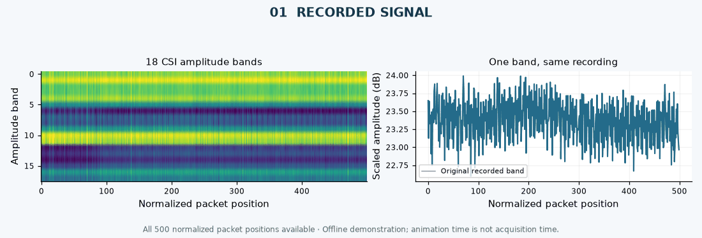

<h1 align="center">MIRA-CSI</h1>

<p align="center"><strong>Missingness-Informed Recognition of Activities from Wi-Fi CSI</strong></p>

<p align="center">Developed by <strong>Eng. Abdessamad Bourkibate</strong></p>

<p align="center"><a href="https://github.com/ABDESSAMAD-BOURKIBATE/mira-csi/releases/tag/v0.1.0">Download models</a> · <a href="#quick-start">Quick start</a> · <a href="MODEL_CARD.md">Model card</a> · <a href="#citation">Citation</a></p>

## Overview

**MIRA-CSI** — *Missingness-Informed Recognition of Activities from Wi-Fi CSI* — is a compact PyTorch research model that makes observation availability explicit when classifying incomplete CSI recordings. This repository provides the model, trained states, a standalone predictor and a completed comparison against two CNN training regimes and official multivariate MiniRocket.

**Developer and research lead:** Eng. **Abdessamad Bourkibate**  
Software & Cybersecurity Engineer | AI & EdTech — **Share'In Holding**

**Status:** experimental offline classifier, evaluated on seven activity labels. The results do not establish broad model superiority or live deployment readiness.

## Quick start

```sh
git clone https://github.com/ABDESSAMAD-BOURKIBATE/mira-csi.git
cd mira-csi
python -m pip install numpy
python -m pip install torch==2.11.0 --index-url https://download.pytorch.org/whl/cpu
```

Download [the verified model/results package](https://github.com/ABDESSAMAD-BOURKIBATE/mira-csi/releases/download/v0.1.0/mira-csi-verified-results.zip) and extract it into the project directory, producing `results/`. Then run:

```sh
python predict.py --checkpoint results/checkpoints/mira_csi_E3_s20261026.pt --input results/demo_input.npy --calibration results/runs/mira_csi_E3_s20261026.json
```

Add `--observed results/demo_observed.npy` for the matched block-loss example. A CPU is sufficient for saved-model inference. The predictor returns an activity label and seven model probabilities. The included example is a public recorded CSI segment.

Exact evaluated package versions are in [`evaluation/package_versions.json`](evaluation/package_versions.json).

## Architecture

<p align="center"></p>

| Component | Implementation |
|---|---|
| Signal input | 18 amplitude bands × 500 normalized packet positions |
| Missingness input | Observation mask and distance to nearest observation |
| Encoder | 1D convolutions: 32 → 64 → 128 channels, GroupNorm, GELU |
| Pooling | Temporal features weighted by local observation coverage |
| Output | Seven logits, with source-validation temperature scaling |
| Model size | 40,871 trainable parameters |

The comparison includes an ordinary amplitude CNN (40,423 parameters), the same CNN with source-only loss augmentation, and the official MiniRocket transform with **9,996 features**. Mask and time-gap representations have prior art; [`PRIOR-ART.md`](PRIOR-ART.md) documents attribution and the scope of this design.

### A real recording through the repair pipeline

<p align="center"></p>

The animation uses the released first-E3 recording, the saved 250-position missing mask and linear interpolation. Colors encode scaled CSI amplitude. Animation time is illustrative; the horizontal axis is normalized packet position. [Visual provenance](docs/assets/VISUAL-PROVENANCE.json) records the source and display limits.

## Evaluation

**60 fitted runs · 3 excluded-environment folds · 5 paired training/mask seeds**

| Model | Complete accuracy (%) | Block 50%, linear (%) |
|---|---:|---:|
| CNN | 24.52 ± 2.17 | 22.19 ± 2.15 |
| CNN + augmentation | 22.54 ± 1.82 | 20.76 ± 1.33 |
| **MIRA-CSI** | **23.73 ± 2.26** | **23.00 ± 1.28** |
| MiniRocket (9,996) | 53.08 ± 0.33 | 19.59 ± 0.88 |

Means ± sample SD across five paired seeds; each seed pools 1,260 held-environment predictions. Room and participant cohort change together, so this protocol cannot isolate a causal room-only effect.

<p align="center"></p>

MiniRocket is stronger on complete inputs and fails substantially under long gaps. MIRA-CSI has limited absolute recognition accuracy; these experiments do not establish a substantial practical advantage over the ordinary CNN. The **[full evaluation](evaluation/README.md)** includes per-seed metrics, repair comparisons, NLL, Brier, ECE and the retained failed first-file inference example.

All **3,048 metric rows** were independently recomputed from saved probabilities in Colab and again locally. The package retains 896,112 probability vectors, including dependent supplementary mask views of the same 1,260 recordings.

## Technology stack

| Role | Languages and libraries |
|---|---|
| Model and inference | Python · PyTorch · NumPy |
| Signal preparation | Python · NumPy · SciPy |
| Reference comparison | Numba · scikit-learn · official MiniRocket source |
| Analysis and figures | pandas · Matplotlib · Pillow |
| Research documentation | Markdown · LaTeX · CFF citation metadata |

## Reproduce

Install `requirements.txt`. Obtain the exact processed public input cache from the [release assets](https://github.com/ABDESSAMAD-BOURKIBATE/mira-csi/releases/tag/v0.1.0), or rebuild it from pinned raw recordings:

```sh
python -m pip install -r requirements.txt
python prepare_data.py
python check_inputs.py
python run_experiment.py --models cnn_clean cnn_augmented mira_csi
python run_experiment.py --models minirocket_9996
python verify_results.py
python summarize_results.py
```

[`protocol.json`](protocol.json) fixes the selection, participant roles, model settings and seeds. The [compute amendment](protocol_amendment_01.json) pairs training/mask seeds for the primary comparison. Extra CNN masks and a previously completed full-grid MiniRocket run remain supplementary sensitivity data.

<details>
<summary><strong>Download contents and provenance</strong></summary>

| Asset | Contents |
|---|---|
| `mira-csi-verified-results.zip` | All 60 trained states, probability arrays, metrics, histories, plots and run records |
| `mira-csi-public-inputs.zip` | Exact public input tensor, manifest, attribution and hashes |
| GitHub source archive | Source code, model card, evaluation summaries and documentation |

SHA256 digests accompany the release. The input cache does not overwrite current software source. Raw-data reconstruction downloads approximately 395 MB; the optional processed cache is smaller.

</details>

## Task boundaries

- Input is processed, recorded CSI from the documented acquisition system.
- Output is one of seven predefined activity labels and its probability vector.
- Ordinary laptop RSSI does not provide this input. Body images, temperature, vital signs and unrestricted through-wall pose reconstruction are outside the evaluated task.
- Synthetic missing positions and offline repair do not establish causal real-time operation. See the [model card](MODEL_CARD.md) for full limitations.

## Citation

Use **Cite this repository** on GitHub or [`CITATION.cff`](CITATION.cff).

```bibtex
@software{bourkibate2026mira,
  author  = {Bourkibate, Abdessamad},
  title   = {{MIRA-CSI}: Missingness-Informed Recognition of Activities from Wi-Fi CSI},
  year    = {2026},
  version = {0.1.0},
  url     = {https://github.com/ABDESSAMAD-BOURKIBATE/mira-csi/releases/tag/v0.1.0}
}
```

Also cite **Alsaify et al.** for the [dataset](https://doi.org/10.17632/v38wjmz6f6.2) and **Dempster, Schmidt and Webb** for [MiniRocket](https://doi.org/10.1145/3447548.3467231) when using those components. This software release has no assigned DOI.

## License and contributions

Original software: **GPL-3.0-or-later**, credited to Abdessamad Bourkibate. MiniRocket retains its original authors and license; the dataset is separately **CC BY 4.0**. See [NOTICE.md](NOTICE.md) and [data attribution](data/README.md).

Reproducible bug reports, documented replications and focused pull requests are welcome. Include the software revision, environment, input hashes and reproduction steps. Keep credentials and private measurements out of public reports.
