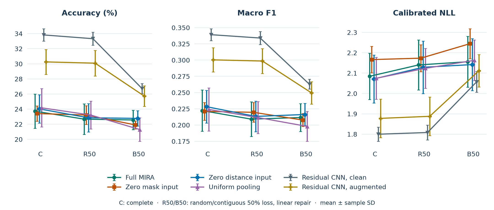
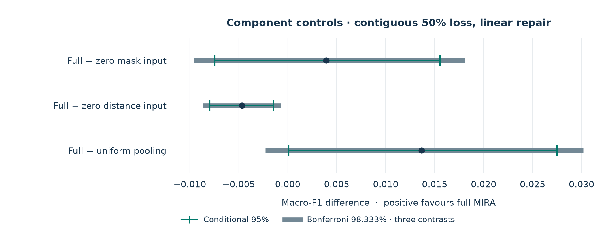
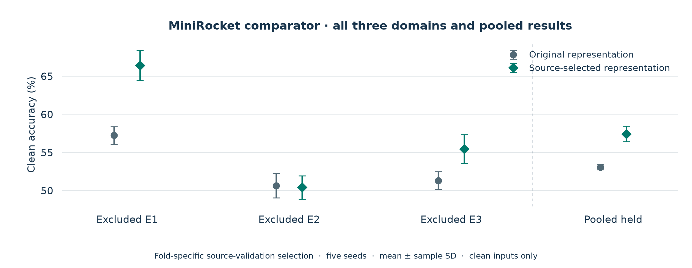

# Frozen component controls and clean representation sensitivity

This follow-up extends the [initial v0.1.0 evaluation](../README.md). The runnable
v0.1.0 saved model and its quick start remain unchanged. The results below are
experimental, post-hoc evidence, not an independent external confirmation set.

## Experiment at a glance

| Item | Fixed scope |
|---|---|
| Recordings | 1,260 selected genuine CSI files; 30 people; three environment/cohort domains |
| Component/capacity fits | Six configurations × three excluded-domain folds × five training seeds = **90 fits** |
| Training seeds | 20261026–20261030 |
| Test conditions per fit | Complete + two 50% loss patterns × three repairs × five masks = **31** |
| Saved metric rows | 90 × 31 × two evaluation domains = **5,580** |
| Saved probability vectors | 90 × 31 × (168 familiar + 420 held files) = **1,640,520** |
| Selection/calibration | Clean source validation only; checkpoints and temperatures frozen before scoring |
| Component protocol | [studies/component_removal/protocol.json](../../studies/component_removal/protocol.json) |

Repeated masks, seeds and probability vectors are views of the same recordings;
they are not new participants or independent trials.

## Six controls on the same held recordings

The four compact configurations retain the same 20-channel network and **40,871
nominal parameters**. Disabled inputs are zeroed rather than changing the input
dimension. Augmentation draws, source partitions, optimizer and selection rules
are matched. Under the defined distance, **`m_t = I[d_t = 0]`**: a position is
observed exactly when its nearest-support distance is zero. The entire mask is
therefore recoverable from distance, and distance is a deterministic function of
the mask. Zeroing the explicit mask channel tests the input encoding, rather than
removal of missingness information; distance and mask-dependent coverage pooling
remain available.

The conventional residual controls have **511,111 parameters**, use clean or
augmented source training, and are not claimed as a novel architecture.

| Configuration | Complete accuracy (%) | R50 linear (%) | B50 linear (%) |
|---|---:|---:|---:|
| Full MIRA | 23.73 ± 2.26 | 22.68 ± 2.03 | 22.56 ± 1.28 |
| Zero explicit mask input | 23.41 ± 1.03 | 23.22 ± 1.23 | 21.90 ± 0.53 |
| Zero distance input | 24.03 ± 1.87 | 22.85 ± 1.87 | 22.77 ± 1.02 |
| Uniform temporal pooling | 24.17 ± 2.54 | 23.22 ± 1.86 | 21.30 ± 1.57 |
| Residual CNN, clean training | 33.83 ± 0.82 | 33.33 ± 0.87 | 26.72 ± 0.67 |
| Residual CNN, augmented | 30.25 ± 1.65 | 30.09 ± 1.70 | 25.72 ± 1.35 |

For each training/mask cell, predictions from the three held folds are pooled
to score all **1,260** files. Corrupted-case scores are averaged over five masks
within a training seed; mean and sample SD then use the five training seeds.
Macro F1 is scored on each pooled confusion matrix. Probabilities are not
ensembled, and fold F1 scores are not averaged to produce pooled F1.

<p align="center"><picture>
  <source media="(prefers-color-scheme: dark)" srcset="../../docs/assets/followup-models-dark.png">
  <source media="(prefers-color-scheme: light)" srcset="../../docs/assets/followup-models-light.png">
  
</picture></p>

Error bars show sample SD across five training-seed summaries. C is complete;
R50/B50 are random/contiguous 50% loss with linear repair. Higher accuracy and
F1 and lower NLL are preferred. These are statistical plots of saved results,
not live Wi-Fi screenshots or a body reconstruction.

### Why 23.00% and 22.56% both appear

The original v0.1.0 primary summary pairs one mask with each training seed:
five training/mask pairs, producing **23.00 ± 1.28%** block-loss accuracy.
The frozen follow-up uses every one of five masks for every training seed:
25 training/mask cells, producing **22.56 ± 1.28%**. Their clean value agrees at
23.73 ± 2.26%. The difference is an aggregation-grid change, not a replacement
of the recordings or an unreported performance gain. Use the matching protocol
and summary when quoting either result.

## Three exploratory component contrasts

Differences are **full MIRA minus the named control**, in B50-linear pooled
macro F1. Positive values favour full MIRA. Ten thousand paired participant-cluster
draws sample ten people with replacement within each of three fixed domains.
The same draw indices are used for every configuration, retaining all seed/mask
views for each person. The adjusted family contains exactly these three contrasts.

| Control | Δ Macro F1 | Conditional 95% | Bonferroni 98.333% |
|---|---:|---:|---:|
| Zero explicit mask input | +0.0039 | [−0.0074, +0.0155] | [−0.0096, +0.0180] |
| Zero distance input | −0.0047 | [−0.0080, −0.0015] | [−0.0086, −0.0007] |
| Uniform temporal pooling | +0.0137 | [+0.0001, +0.0275] | [−0.0023, +0.0302] |

<p align="center"><picture>
  <source media="(prefers-color-scheme: dark)" srcset="../../docs/assets/followup-components-dark.png">
  <source media="(prefers-color-scheme: light)" srcset="../../docs/assets/followup-components-light.png">
  
</picture></p>

The fitted-grid mean slightly favours removing distance here. The mask-input
contrast is inconclusive; the pooling benefit does not survive this family
adjustment. These approximate participant percentile ranges assume within-domain
participant exchangeability and condition on the existing fitted models, selected
recordings and masks; they exclude retraining and new-room uncertainty. Secondary
ranges are unadjusted. Even a family-adjusted range excluding zero does not
guarantee a consistent effect direction across training seeds or future fits.

### Direction and variation across the fitted seeds

For each training seed, full-MIRA F1 minus control F1 is calculated after the
existing average over five B50-linear masks. Each underlying training/mask score
first pools all 1,260 held files. The mean, sample SD and strict positive/negative
counts below use the five paired seed differences; they are descriptive rather
than confidence intervals or a new hypothesis test.

| Control | Paired Δ F1, mean ± seed SD | Positive seeds | Negative seeds |
|---|---:|---:|---:|
| Zero explicit mask input | +0.0039 ± 0.0126 | 3/5 | 2/5 |
| Zero distance input | −0.0047 ± 0.0117 | 2/5 | 3/5 |
| Uniform temporal pooling | +0.0137 ± 0.0190 | 4/5 | 1/5 |

Positive means full MIRA has higher F1. Every contrast changes sign across these
five fitted seeds. The negative mean for distance and its conditional adjusted
participant range can coexist with full MIRA doing better at two seeds: the two
summaries vary different units. This limits claims of a stable benefit under
retraining and does not establish that all additions help independently.

Source: computed from the saved
[mask-averaged per-training-seed scores](summaries/held-mask-averaged-per-seed.csv)
by paired subtraction, with no new model fitting or participant resampling.
The [15 differences](summaries/component-differences-per-seed.csv),
[three-row summary](summaries/component-differences-seed-summary.csv), and
[calculation provenance](summaries/component-seed-effects-provenance.json)
retain all five seeds and the source-file digest. The existing bootstrap results
and their three-comparison family are unchanged.

## Separate clean-input MiniRocket sensitivity

The official **9,996-feature MiniRocket** comparator is evaluated with its original
representation and a source-selected representation. Each outer fold selects
from five fixed candidates using its **own source-validation macro F1** at seed
20261026. The representation is then fixed across five seeds. Scores are not
pooled across folds to select it: another fold may contain the current target
domain. E1 selects temporal per-band standardization; E2/E3 select scalar
per-recording standardization.

| MiniRocket representation | Clean accuracy (%) | Macro F1 | NLL | Brier |
|---|---:|---:|---:|---:|
| Original | 53.08 ± 0.33 | 0.531 ± 0.003 | 1.395 ± 0.049 | 0.639 ± 0.008 |
| Source-selected | 57.44 ± 1.04 | 0.574 ± 0.009 | 1.259 ± 0.040 | 0.586 ± 0.013 |

| Excluded domain/cohort | Original accuracy (%) | Source-selected accuracy (%) |
|---|---:|---:|
| E1 | 57.24 | 66.43 |
| E2 | 50.67 | 50.43 |
| E3 | 51.33 | 55.48 |

<p align="center"><picture>
  <source media="(prefers-color-scheme: dark)" srcset="../../docs/assets/followup-minirocket-dark.png">
  <source media="(prefers-color-scheme: light)" srcset="../../docs/assets/followup-minirocket-light.png">
  
</picture></p>

All 30 fitted states were sealed before new held scoring; six first-seed fits
were reused and 24 additional fits trained. The overall gain is 4.37 percentage
points; E2 does not improve. **57.44% belongs to MiniRocket, not MIRA.** This
clean-only stage uses full-recording statistics. It establishes neither loss
robustness nor a leakage-safe normalization procedure under hidden values.

## Audit and files

All 5,580 component-control rows were independently reconstructed from saved
probabilities, maximum absolute difference **4.44×10⁻¹⁶**. A separate CPU audit
verified all 90 source checkpoint byte hashes and reproduced 15,120 source-validation
prediction views without a class-label mismatch, with maximum CPU/T4 logit difference
6.20×10⁻⁶. The Colab post-evaluation audit reported unchanged checkpoint hashes;
the probability-only local audit did not reload post-evaluation weights.
The original source freeze and the evaluation archive remain separate.

A separate bootstrap spot-check calculated **500 accuracy, 500 macro-F1, 500 NLL
and 500 Brier values**, directly from weighted original probabilities: 2,000 scalar
values in total. They match the participant-aggregation calculations to maximum
absolute difference **8.88×10⁻¹⁶**. This spot-check is not an extra performance study.

The clean MiniRocket audit checked 12,600 saved held probability vectors, all 30
checkpoint hashes, fold-specific selection, and the recorded source-fit freeze.
No extra held forward passes were used by that verification.

| File | Contents |
|---|---|
| [held-summary.csv](summaries/held-summary.csv) | 42 summaries: six models × seven pattern/repair groups, all five metrics |
| [held-mask-averaged-per-seed.csv](summaries/held-mask-averaged-per-seed.csv) | 210 seed summaries before five-seed aggregation |
| [per-environment-summary.csv](summaries/per-environment-summary.csv) | All three held domains, all six configurations and all repairs |
| [primary-component-contrasts.csv](summaries/primary-component-contrasts.csv) | Three B50-linear F1 contrasts, both percentile ranges |
| [component-differences-per-seed.csv](summaries/component-differences-per-seed.csv) | 15 paired B50-linear F1 differences after the existing five-mask average |
| [component-differences-seed-summary.csv](summaries/component-differences-seed-summary.csv) | Three means, sample seed SDs and positive/negative counts; descriptive, not confidence intervals |
| [component-seed-effects-provenance.json](summaries/component-seed-effects-provenance.json) | Public source filename, source digest, formulas and inference scope for the seed-effect summaries |
| [component-contrasts-secondary-and-primary.csv](summaries/component-contrasts-secondary-and-primary.csv) | All 84 descriptive/contrast rows; only three primary-family ranges are adjusted |
| [minirocket-clean-summary.csv](summaries/minirocket-clean-summary.csv) | Original/source-selected pooled clean results |
| [minirocket-clean-per-fold-seed.csv](summaries/minirocket-clean-per-fold-seed.csv) | Every clean comparator fold and seed |
| [minirocket-clean-pooled-per-seed.csv](summaries/minirocket-clean-pooled-per-seed.csv) | 1,260-file clean scores per seed |
| [verification-summary.json](summaries/verification-summary.json) | Scope, counts, artifact digests and audit limitations |
| [render_followup_visuals.py](../../docs/render_followup_visuals.py) | Renders transparent day/night plots from these CSVs |

CSV accuracy values are fractions; displayed tables multiply them by 100.
Macro-F1 differences retain their 0–1 scale. Plot rendering requires NumPy,
pandas, Matplotlib and Pillow; run `python docs/render_followup_visuals.py` from
the repository root. It reads only these summary CSVs and fits no model.

The existing v0.1.0 release assets cover the original 60-fit experiment. They do
not include the new 90-fit checkpoints.

## Reproduce the frozen analysis

Keep the source-trained and verified-evaluation ZIPs separate. The analysis reads
them in place; do not extract evaluation files over the source freeze. Given the
matching study code, public input cache and the two named archives, the analysis
command is:

```sh
python studies/component_removal/analysis_evaluation.py \
  --source-archive studies/component_removal/local-assets/supplement/archives/MIRA-CSI-source-trained-final-20261028.zip \
  --evaluation-archive studies/component_removal/local-assets/supplement/archives/MIRA-CSI-verified-evaluation-20261028.zip \
  --protocol studies/component_removal/protocol.json \
  --data-root data \
  --output-root studies/component_removal/local-runs/recomputed-analysis \
  --bootstrap-indices studies/component_removal/local-assets/supplement/analysis/participant-bootstrap-indices.npz \
  --bootstrap 10000 --seed 20261028
```

Extract the public supplement into `studies/component_removal/local-assets/supplement/`
first. Windows users can copy the single-line command from the [study guide](../../studies/component_removal/README.md#recalculate-the-completed-saved-results).
The command uses relative, portable paths and does not refit a model or temperature.
The checksum receipt and complete probability archive support recalculation;
the CSV summaries alone support plot rendering but are insufficient to rerun
participant resampling. Follow-up code/data packaging must preserve the pinned
implementation and input hashes.
