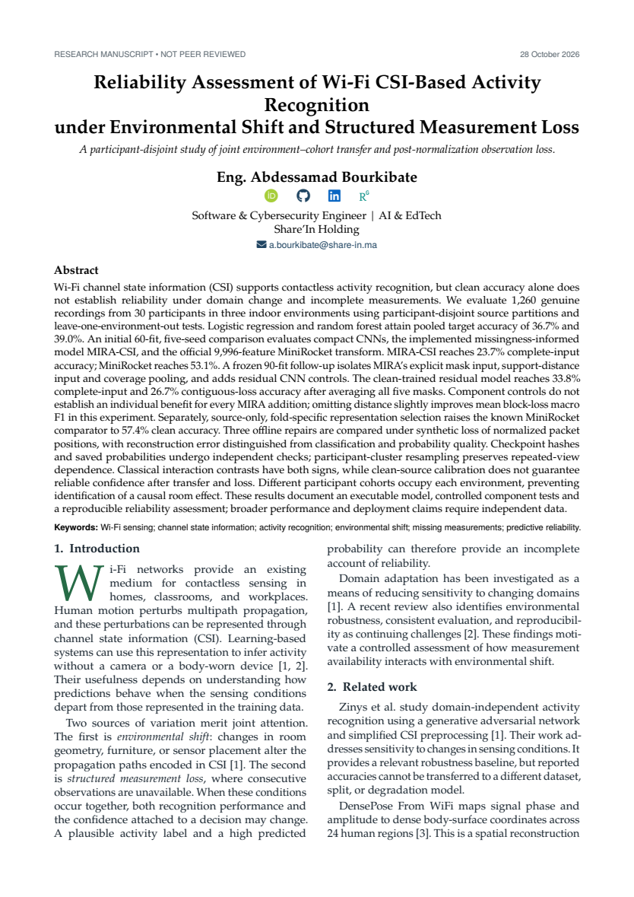

# Research manuscript

**Reliability Assessment of Wi-Fi CSI-Based Activity Recognition under Environmental Shift and Structured Measurement Loss**<br>
Eng. **Abdessamad Bourkibate** · 28 October 2026

[Read the complete PDF](manuscript.pdf) · [LaTeX source](source/main.tex) · [File hashes](MANIFEST.json) · [Verified evaluation](../evaluation/component-controls/README.md)

This is the **unreviewed author manuscript**: 21 pages, 14 tables, 14 figures and
21 references. It has not been accepted by a journal and has no assigned DOI.
The current author version includes the author-approved AI-assistance declaration
on page 20. Numerical results are unchanged. The [v0.2.0 archived PDF](https://github.com/ABDESSAMAD-BOURKIBATE/mira-csi/releases/download/v0.2.0/MIRA-CSI-reliability-manuscript-20261028.pdf)
predates that declaration; its published checksums remain valid for that archived version.
The contribution is an executable model and a bounded, reproducible reliability study; the reported
component findings are mixed and do not establish broad model superiority.

<p align="center"><a href="manuscript.pdf"></a></p>

## What is included

| File | Purpose |
|---|---|
| [manuscript.pdf](manuscript.pdf) | Complete compiled author version |
| [source/](source/) | Main TeX file, two included result files, referenced figures and retained CAS support files |
| [results-page.png](results-page.png) | Actual rendered page with the six-configuration result table |
| [component-page.png](component-page.png) | Actual rendered page with model-score plots and paired component contrasts |
| [MANIFEST.json](MANIFEST.json) | SHA256 values tying this source package to the PDF |

The 90-fit follow-up and the separate clean-input MiniRocket representation
sensitivity retain their own frozen protocols and numerical artifacts. They
are distinct from the original 60-fit v0.1.0 comparison. Read the captions before
comparing paired-mask summaries with full-mask-grid summaries.

The manuscript discloses room/cohort confounding, synthetic masking after packet
normalization, offline future-aware repair, conditional uncertainty and known
historical target results. Body meshes and wavefront illustrations explain
concepts; they are not measured poses, thermal images or solved RF fields.

## Compile the source

Open `source/` as a LaTeX project and select `main.tex` as the main document.
Overleaf compilation was checked. A local TeX installation with the referenced
packages can compile from that directory using `latexmk -pdf main.tex`.
Local package versions can affect line breaks; the checked PDF and its hash
identify the version distributed here.

The CAS class, style and bibliography files retain their LaTeX Project Public
License notices and upstream README/manifest. Dataset and scaling-code rights
remain separate, as recorded in [NOTICE.md](../NOTICE.md) and [data attribution](../data/README.md).

## Cite this author version

```bibtex
@unpublished{bourkibate2026reliability,
  author = {Bourkibate, Abdessamad},
  title = {Reliability Assessment of Wi-Fi CSI-Based Activity Recognition under Environmental Shift and Structured Measurement Loss},
  year = {2026},
  note = {Unreviewed author manuscript, 28 October 2026},
  url = {https://github.com/ABDESSAMAD-BOURKIBATE/mira-csi/tree/main/paper}
}
```

Cite the original dataset and MiniRocket separately when using them. Versioned
source and SHA256 records identify the exact author version distributed here.
